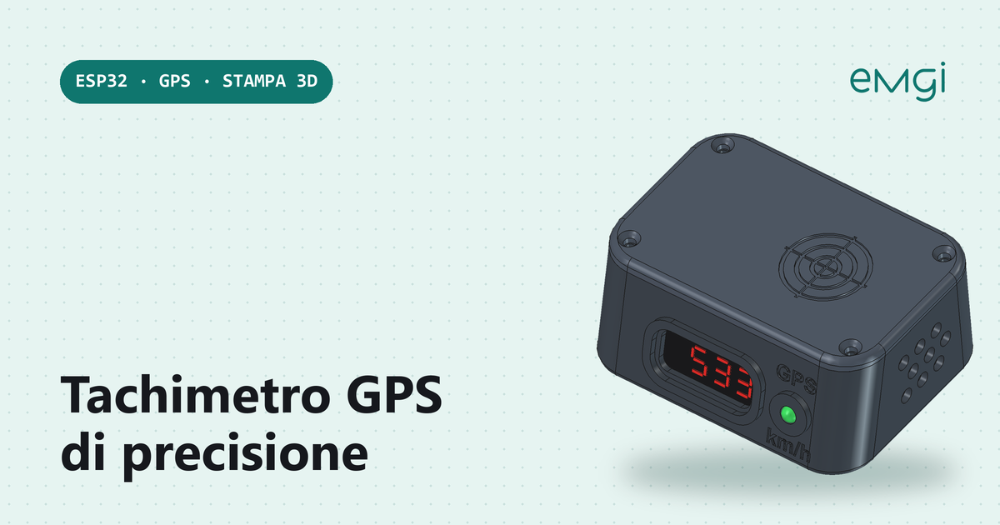
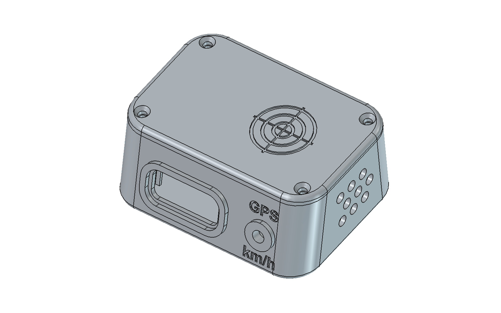

# ESP32 GPS speedometer with TM1637, RGB LED and automatic day/night brightness

> 📖 **Full article with wiring diagram, photos and step-by-step explanations (in Italian):**  
> **[ESP32 GPS speedometer with TM1637, RGB LED and automatic day/night brightness – www.emgi.it](https://www.emgi.it/2026/04/10/tachimetro-gps-di-precisione/)**
>
> More electronics, Arduino, ESP32, Home Assistant and 3D printing projects at **[www.emgi.it](https://www.emgi.it)**

Building a DIY GPS speedometer is a very interesting project because it combines electronics, programming, a web interface and 3D printing in one compact device. In this final version I built an **ESP32-based GPS speedometer** that shows the speed in real time on a **4-digit TM1637** display, keeps a **persistent history in flash**, serves a **polished web page over a Wi-Fi access point**, drives a **gradient RGB LED** whose colour changes with speed, and automatically adjusts **day/night brightness** based on sunrise and sunset calculated locally from the GPS position.

The system uses a **GY-NEO6MV2** module to get the speed from the GPS signal, an **ESP32 Dev Module** to run everything and a **0.36″ TM1637** display that shows three integer digits and one decimal, e.g. **53.3 km/h** or **123.4 km/h**.

## Main features

- speed shown in **km/h** with one decimal place
- speed read from **GPS**
- **TM1637 4-digit** display
- correct display format, e.g. **53.3** and not **5.3.3**
- **polished web page** hosted directly on the ESP32
- runs as a **Wi-Fi access point**
- **live telemetry** with speed, satellites, HDOP, average and maximum
- **history chart** of average and peak speed
- **history stored in flash** with **LittleFS**
- history export to **CSV**
- **common-cathode RGB LED** with a smooth colour transition depending on speed
- **automatic day/night brightness profiles** based on sunrise and sunset
- RGB LED and display brightness adjustable from the web page
- settings stored permanently in flash

## Parts used

- 1 × **ESP32 Dev Module**
- 1 × **GY-NEO6MV2 GPS module**
- 1 × **TM1637 4-digit 0.36″ display**
- 1 × **common-cathode RGB LED**
- 3 × **220 Ω** or **330 Ω** resistors
- Dupont wires
- USB power for the ESP32
- optional 3D-printed enclosure

## Libraries to install in the Arduino IDE

- **TinyGPSPlus**
- **TM1637Display**
- **ArduinoJson**

## Wiring

Board: **ESP32** (Dev Module). Pins checked against the sketch (`GPS_RX_PIN 16`, `GPS_TX_PIN 17`, `TM1637_CLK_PIN 18`, `TM1637_DIO_PIN 19`, `RGB_R/G/B_PIN 25/26/27`).

### GY-NEO6MV2 GPS module

| GPS | ESP32 |
|---|---|
| VCC | 5V |
| GND | GND |
| TX | GPIO16 (RX2) |
| RX | GPIO17 (TX2) |

### TM1637 4-digit display

| TM1637 | ESP32 |
|---|---|
| VCC | 5V |
| GND | GND |
| CLK | GPIO18 |
| DIO | GPIO19 |

### Common-cathode RGB LED

| RGB LED | ESP32 |
|---|---|
| common cathode | GND |
| red anode | 220–330 Ω resistor → GPIO25 |
| green anode | 220–330 Ω resistor → GPIO26 |
| blue anode | 220–330 Ω resistor → GPIO27 |

- The GPS TX goes to the ESP32 RX (GPIO16) and vice versa.
- The GPS needs a clear view of the sky for the first fix (it can take a few minutes from a cold start).

### Power

| Use | How to power it |
|---|---|
| Bench / home | ESP32 USB port at 5 V |
| Car | USB adapter in the cigarette-lighter socket (12 V → 5 V, at least 1 A) connected to the ESP32 USB |

- GPS, display and LED take 5 V and GND from the ESP32 **5V/VIN** and **GND** pins: total consumption stays below 200 mA.
- The GY-NEO6MV2 module has an on-board 3.3 V regulator: power it from 5 V; its TX/RX lines already work at 3.3 V and are compatible with the ESP32.
- Mount the GPS with the antenna facing the sky (under the windscreen is fine).

## Repository contents

| Path | Description |
|---|---|
| `GPS_Speedometer/GPS_Speedometer.ino` | Arduino sketch |
| `images/` | Photos and images |

## How to use it

1. Open [`GPS_Speedometer/GPS_Speedometer.ino`](GPS_Speedometer/GPS_Speedometer.ino) in the Arduino IDE.
2. Partition Scheme: a **No OTA** variant with a large file system; Flash Size according to your board (usually 4 MB).
3. Upload, connect to the Wi-Fi network **GPS-Speedometer** (password `12345678`, change it in `AP_PASS`) and open `http://192.168.4.1`.
4. The time zone is set for Italy (`TZ_ITALY`); change the POSIX string for your country.

Wiring diagram, details and troubleshooting: **[article on www.emgi.it](https://www.emgi.it/2026/04/10/tachimetro-gps-di-precisione/)** (in Italian).

## License

- Code and configuration: [MIT](LICENSE)
- 3D models, diagrams and images: [CC BY-SA 4.0](https://creativecommons.org/licenses/by-sa/4.0/)

---

**Author:** Massimiliano Sandrin – **[eMGi.it](https://www.emgi.it)** · Questions and comments below the [article on the website](https://www.emgi.it/2026/04/10/tachimetro-gps-di-precisione/).

## 3D-printed case (wedge "pebble" dashboard case)

Soft-curved wedge case (86 x 64 x 32 mm + 3.2 mm lid) with the TM1637 display and the 5 mm RGB LED on the 15 degree tilted front panel. The GPS antenna sits under the thin lid, so no external antenna is needed. No mounting ears: fix it to the dashboard with VHB tape or Dual Lock.

| File | Description |
|---|---|
| `case_3d/stl/tachimetro_base.stl` | Base, print on its bottom face, no supports |
| `case_3d/stl/tachimetro_coperchio.stl` | Lid, already flipped (outer face on the bed), no supports |
| `case_3d/step/case_tachimetro_gps.step` | STEP of the assembled case |
| `case_3d/freecad/` | FreeCAD 1.1 document and the parametric generator script (`genera_case.py`, parameters at the top) |

**Print settings:** PETG, nozzle 235 C, bed 80 C, 45 mm/s, 0.2 mm layers, 3 walls, 20% infill, no supports.

**Parts and dimensions used by the case**

| Part | Size |
|---|---|
| ESP32 DevKit (30 pin, USB-C, no soldered headers) | 51 x 28 mm, 4 mounting holes 47.4 x 23.8 mm |
| TM1637 0.36" 4-digit display module | PCB 45 x 23 mm, total height 9 mm, digits 30 x 14 mm |
| GY-GPSV3-NEO (NEO-6M) | board 36 x 26 mm + separate ceramic antenna 25 x 25 mm |
| LED | 5 mm RGB, common cathode |

**Assembly**
1. Screw the ESP32 on its 4 standoffs with M2.5 x 6 self-tapping screws. The USB-C connector comes out of the hole in the left wall.
2. Slide the TM1637 module into the two guides behind the front window.
3. Push the 5 mm RGB LED into the front hole and solder the wires.
4. Slide the GPS board and the antenna into the rails under the lid (from the right side) and fix them with tape or a drop of hot glue.
5. Close the lid with 4 screws (pilot hole 2.6 mm, through hole 3.4 mm).

**Wiring used by the sketch**

| Signal | ESP32 pin |
|---|---|
| GPS RX / TX | GPIO16 / GPIO17 (UART2) |
| TM1637 CLK / DIO | GPIO18 / GPIO19 |
| RGB LED R / G / B | GPIO25 / GPIO26 / GPIO27 |
